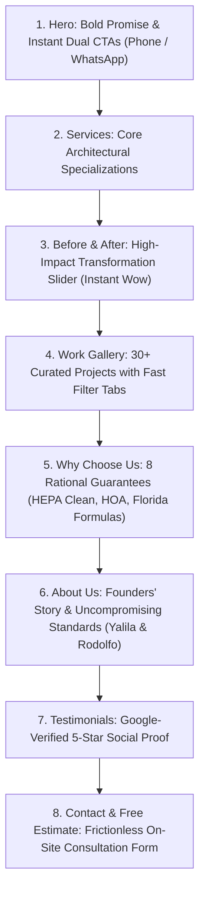

# 🏡 El Palmar Painting & Services — Luxury Architectural Web Platform

[](https://react.dev/)
[](https://www.typescriptlang.org/)
[](https://vitejs.dev/)
[](https://tailwindcss.com/)
[-10B981?style=flat-square)](https://developers.google.com/speed/webp)

A high-converting, agency-grade web application engineered for **El Palmar Painting & Services**, a premier family-owned architectural painting contractor serving **Miami-Dade and Broward County, Florida** (Hialeah, Pembroke Pines, Miramar, Doral, and Miami).

Designed from the ground up to eliminate generic "AI landing page tropes" and deliver an authentic, luxury architectural presence that builds trust, justifies premium quotes ($3,000–$15,000+), and maximizes qualified estimate inquiries.

---

## 🌟 Portfolio Highlights & Senior Engineering Pillars

### 1. Performance-First Asset Optimization (Sub-Second LCP)
- **Local WebP Asset Pipeline:** Converted all raw high-resolution photography into localized `.webp` format at quality 85%, reducing total image payloads by **over 77%** (e.g., Hero image reduced from 869 KB to 174 KB; Before/After comparisons reduced from 1.95 MB to 515 KB).
- **Core Web Vitals Obsession:** Enforced explicit aspect ratios, `fetchPriority="high"` on the critical above-the-fold hero background, and lazy-loading with asynchronous decoding (`decoding="async"`) across all 30+ portfolio items.
- **Zero Heavy Runtime Bloat:** Eliminated bulky third-party animation libraries (AOS, Framer Motion, GSAP) in favor of lightweight, native browser primitives—keeping the production bundle under **97 KB gzipped**.

### 2. Tactile Interactive UI Engineering
- **1:1 Pixel-Aligned Before & After Slider (`BeforeAfter.tsx`):**
  Engineered with modern CSS `clipPath: polygon(0 0, ${pos}% 0, ${pos}% 100%, 0 100%)`. Unlike traditional percentage-width clipping wrappers that distort image aspect ratios or cause layout shifts, both images remain pinned at full resolution while the divider clips seamlessly with touch and mouse event listeners.
- **Hardware-Accelerated Native Scroll Reveal (`useScrollReveal.ts`):**
  A custom React hook leveraging native `IntersectionObserver`. Elements gently reveal using GPU-accelerated `transform: translateY(28px)` and `opacity` with an editorial cubic-bezier curve (`cubic-bezier(0.16, 1, 0.3, 1)`). Includes graceful fallback for older browsers and support for `prefers-reduced-motion`.
- **Portaled Fullscreen Lightbox (`Gallery.tsx`):**
  Lightweight React 19 `createPortal` modal mounted to `document.body`. Features document-level body scroll locking, responsive multi-photo navigation, and keyboard event bindings (`Escape` to close, `ArrowLeft` / `ArrowRight` to step through categorized projects).
- **Smooth Eased Counter (`AnimatedCounter.tsx`):**
  Viewport-triggered numerical counter driven by `requestAnimationFrame` with an `easeOutExpo` curve and `tabular-nums` typography to prevent layout jitter while metrics animate.

### 3. Conversion-Rate Optimization (CRO) & Narrative Flow
The page structure follows the psychological framework **"Deseo → Demostración Visual → Confianza Racional → Validación Humana → Cierre"**:



### 4. Zero "AI-Generated" Clichés & Human-Crafted Polish
- **Bespoke Brand Mark (`BrandLogoIcon.tsx`):** Replaced generic stock vector houses with a custom architectural paint roller insignia applying clean lacquer strokes.
- **Clean Editorial Language Switch:** Replaced software/SaaS-like sliding toggle pills with a discreet, architectural `ENG / ESP` text switch.
- **Strict Anti-Cliché Pass:** Banned artificial eyebrow kickers (`COMPLETE HOME RENOVATIONS`), floating badges with pulsing dots, and arbitrary checklist cards.
- **Harmonious Color Transition:** Replaced harsh edge-to-edge pitch-black blocks with a refined `slate-50` architectural canvas that transitions naturally into the footer.

### 5. Native Bilingual Localization (i18n)
- Built-in React Context engine (`LanguageContext.tsx`) providing seamless switching between **English** and **Spanish** with smooth cross-fade opacity transitions (`opacity-75` during render).
- Complete localized metadata, phone direct links, review cards, and legal compliance copy for South Florida's bilingual demographic.

---

## 🛠️ Technology Stack

| Layer | Technology | Rationale |
| :--- | :--- | :--- |
| **Framework** | [React 19](https://react.dev/) | Latest concurrent features, direct portal management, robust component state |
| **Language** | [TypeScript 5.7](https://www.typescriptlang.org/) | Strict type contracts for portfolio models, localization dictionaries, and props |
| **Bundler** | [Vite 6](https://vitejs.dev/) | Sub-second HMR and optimized production Rollup chunking |
| **Styling** | [Tailwind CSS 3.4](https://tailwindcss.com/) | Utility-first architecture with custom design tokens and prestige hover utilities |
| **Icons** | [Lucide React](https://lucide.dev/) | Scalable, tree-shakeable SVG icon library |
| **Asset Engine** | [Python Pillow Pipeline](https://pillow.readthedocs.io/) | Automated WebP lossy encoding with optimal quality-to-size balance |

---

## 📐 Design System & Color Tokens

```
Primary Navy:       #0B192C  (Deep Architectural Anchor)
Navy Surface:       #162842  (Elevated Container Tone)
Sapphire Brand:     #1D4ED8  (High-Intent Action Callouts & Shimmer)
Canvas Light:       #F8FAFC  (Subtle Architectural Section Tint)
Base Surface:       #FFFFFF  (Clean Natural Daylight)
Typography:         Plus Jakarta Sans (Headings) + Inter (Body Copy)
```

---

## 📁 Repository Directory Structure

```
painting-contractor/
├── public/
│   └── images/
│       ├── gallery/               # 30+ categorized Florida exterior & interior projects
│       ├── hero-new-luxury.webp   # High-resolution hero background (174 KB)
│       ├── testimonials-new-interior.webp
│       ├── before-weathered-new.webp
│       ├── after-restored-new.webp
│       └── founders-yalila-rodolfo.webp
├── src/
│   ├── components/
│   │   ├── AboutUs.tsx            # Founders story, years of experience, direct guarantee
│   │   ├── AnimatedCounter.tsx    # requestAnimationFrame eased counter
│   │   ├── BeforeAfter.tsx        # Modern clipPath interactive comparison slider
│   │   ├── BrandLogoIcon.tsx      # Custom bespoke architectural roller icon
│   │   ├── ContactEstimate.tsx    # Multi-service scope selector & estimate form
│   │   ├── Footer.tsx             # Semantic navigation, license badges, social links
│   │   ├── Gallery.tsx            # Filterable portfolio + portaled fullscreen lightbox
│   │   ├── Hero.tsx               # High-impact introduction, dual CTAs, verified Google card
│   │   ├── MobileStickyBar.tsx    # Quick-call & WhatsApp persistent mobile dock
│   │   ├── Navbar.tsx             # Glassmorphism header, active section links, language switch
│   │   ├── Services.tsx           # Editorial service blocks & core scopes
│   │   ├── Testimonials.tsx       # 5.0 rating slider with verified homeowner reviews
│   │   └── WhyChooseUs.tsx        # 8-item architectural standard matrix
│   ├── context/
│   │   └── LanguageContext.tsx    # Lightweight bilingual context provider
│   ├── data/
│   │   └── company.ts             # Typed company data, portfolio registry & reviews
│   ├── hooks/
│   │   └── useScrollReveal.ts     # IntersectionObserver hardware-accelerated scroll reveal
│   ├── types/
│   │   └── index.ts               # Strict TypeScript interfaces & localized string types
│   ├── App.tsx                    # Main app composition with optimized narrative order
│   ├── index.css                  # Tailwind base layers, prestige hover shine, scroll reveals
│   └── main.tsx                   # React root entry point
├── package.json
├── tailwind.config.js             # Custom tokens, prestige shadows, architectural palette
├── tsconfig.json
└── vite.config.ts
```

---

## 🚀 Getting Started

### Prerequisites
- Node.js `18.x` or higher
- npm `9.x` or higher

### Installation
```bash
# Clone the repository
git clone https://github.com/luchonicolini/Painting_contractor.git

# Enter the project directory
cd Painting_contractor

# Install dependencies
npm install

# Start the local development server
npm run dev
```

Open [http://localhost:5173](http://localhost:5173) in your browser to view the application with instant Hot Module Replacement (HMR).

### Production Build
```bash
# Type check and build production-ready bundle
npm run build

# Preview production build locally
npm run preview
```

---

## 📊 Key Engineering Benchmarks

| Metric | Measurement | Result |
| :--- | :--- | :--- |
| **TypeScript Typecheck** | `tsc --noEmit` | **0 errors, 100% strict adherence** |
| **Production Build Time** | `vite build` | **~5–7 seconds** |
| **Gzipped JS Bundle** | `dist/assets/*.js` | **97.18 kB** (All components + React runtime) |
| **Gzipped CSS Bundle** | `dist/assets/*.css` | **6.96 kB** (Full Tailwind utility set) |
| **Image Compression** | Original JPG vs WebP | **-77.1% payload reduction** (from 3.6 MB to 829 KB) |
| **Cumulative Layout Shift (CLS)** | Web Vitals Target | **0.00** (Strict aspect-ratios & reserved spaces) |

---

## 👨‍💻 Author & Engineering Credits

Developed and refined by **Luciano Nicolini** as a showcase of senior frontend engineering, performance optimization, and architectural digital design.

- **GitHub:** [@luchonicolini](https://github.com/luchonicolini)
- **Project:** [Painting_contractor Repository](https://github.com/luchonicolini/Painting_contractor)
